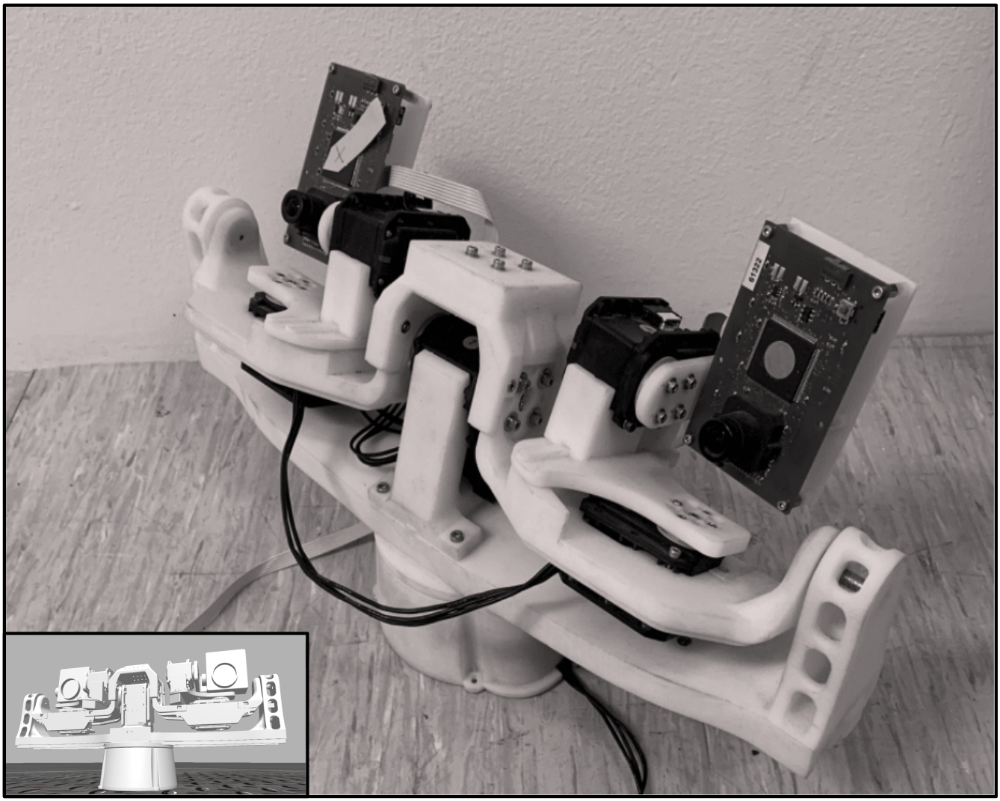

<div align="center">

# :robot: KTH Robotic Head

### 6-DOF Servo-Driven Head with ROS Automation & Event Camera Tracking

[](https://github.com/omkarbhoite25/KTH-Neuro-Computing-Systems/actions/workflows/cmake-single-platform.yml)
[](https://github.com/omkarbhoite25/KTH-Neuro-Computing-Systems/actions/workflows/python-anaconda.yml)
[](https://github.com/omkarbhoite25/KTH-Neuro-Computing-Systems/actions/workflows/c-cpp-make.yml)
[](LICENSE)
[](http://wiki.ros.org/noetic)
[](#test_tube-tests)

A **6-DOF robotic head** controlled by Dynamixel MX-28 servos via ROS Noetic, with **4 automation modes**: keyboard teleop, sinusoidal scanning, pre-programmed sequences, and event camera tracking. Includes a **C accelerator** for real-time event processing and a comprehensive safety layer.



*Robotic head platform with 6 MX-28 servos and eDVS4337 event camera*

</div>

---

**Project by:** Omkar Vilas Bhoite
**Advised by:** Prof. Jorg Conradt & Juan Pablo Romero Bermudez, KTH Royal Institute of Technology

---

> :warning: **Hardware Testing Note:** Code up to and including commit `6f05385` ("Update README.md") has been tested on the physical hardware. All commits after `6f05385` — including the refactoring (Part A), automation package (Part B), and security hardening (Part C) — have **not yet been tested on the actual robotic head** and should be verified on hardware before deployment. See the [Hardware Test Checklist](#white_check_mark-hardware-test-checklist) below.

---

## :sparkles: Key Features

| | Feature | Description |
|:--|:--------|:------------|
| :mechanical_arm: | **6-DOF Control** | Head yaw/pitch + independent left/right eye yaw/pitch, all via ROS topics |
| :shield: | **Safety Layer** | Position clamping, rate limiting, emergency stop, graceful torque-disable shutdown |
| :keyboard: | **Keyboard Teleop** | WASD + arrow key control with adjustable step size |
| :cyclone: | **Scanning/Patrol** | Smooth Lissajous sinusoidal pattern for room coverage |
| :clapper: | **Motion Sequences** | YAML-defined keyframe sequences with 50Hz interpolation (nod, shake, look around, etc.) |
| :eye: | **Event Camera Tracking** | eDVS-driven two-tier head/eye tracking with decay accumulator + optional C accelerator |
| :gear: | **Mode Manager** | Exclusive mode coordination — only one mode controls motors at a time |
| :test_tube: | **Tested** | Unit tests, integration tests, and 6 GitHub Actions CI workflows |

---

## :fast_forward: Quick Start

```bash
# 1. Build all packages
cd Multi_Motor/
catkin_make && source devel/setup.bash

# 2. Launch (3 terminals for manual control)
roscore                                                                 # Terminal 1
rosrun multi_motor multi_motor                                          # Terminal 2
rostopic pub -1 /head_lr multi_motor/Control "{position: 2200}"         # Terminal 3

# 3. Or launch full automation system
roslaunch head_automation head_automation.launch

# 4. Switch modes
rostopic pub -1 /head/mode_command head_automation/ModeCommand "{mode: scanning, action: start}"
rostopic pub -1 /head/mode_command head_automation/ModeCommand "{mode: sequence, action: start, param: nod_yes}"
rostopic pub -1 /head/mode_command head_automation/ModeCommand "{mode: idle, action: start}"
```

---

## :book: Table of Contents

- [:mechanical_arm: Hardware](#mechanical_arm-hardware)
- [:package: Prerequisites](#package-prerequisites)
- [:hammer_and_wrench: Installation](#hammer_and_wrench-installation)
- [:rocket: Automation Modes](#rocket-automation-modes)
- [:building_construction: Architecture](#building_construction-architecture)
- [:satellite: ROS Interface](#satellite-ros-interface)
- [:gear: Configuration](#gear-configuration)
- [:shield: Safety & Security](#shield-safety--security)
- [:test_tube: Tests](#test_tube-tests)
- [:wrench: Development](#wrench-development)
- [:mag: Troubleshooting](#mag-troubleshooting)

---

## :mechanical_arm: Hardware

| Motor | ID | Topic | Range (ticks) | Default | Description |
|:------|:---|:------|:--------------|:--------|:------------|
| DXL1 | 1 | `/head_lr` | 1500–2500 | 2000 | :left_right_arrow: Head left-right (yaw) |
| DXL2 | 2 | `/head_ud` | 2000–2900 | 2450 | :arrow_up_down: Head up-down (pitch) |
| DXL3 | 3 | `/reye_lr` | 1500–2500 | 2000 | :left_right_arrow: Right eye left-right |
| DXL4 | 4 | `/leye_lr` | 1500–2500 | 2000 | :left_right_arrow: Left eye left-right |
| DXL5 | 5 | `/reye_ud` | 1700–2300 | 2000 | :arrow_up_down: Right eye up-down |
| DXL6 | 6 | `/leye_ud` | 1700–2300 | 2000 | :arrow_up_down: Left eye up-down |

| Property | Value |
|:---------|:------|
| **Servo Model** | Dynamixel MX-28 (4096 positions, 0–360°) |
| **Connection** | USB via U2D2 adapter (`/dev/ttyACM0`) |
| **Baudrate** | 1,000,000 bps |
| **Protocol** | Dynamixel Protocol 1.0 |
| **Event Camera** | eDVS4337 (128×128 silicon retina, optional for tracking mode) |

---

## :package: Prerequisites

- **Ubuntu 20.04**
- **[ROS Noetic](https://wiki.ros.org/noetic/Installation)**
- **Dynamixel SDK:** `sudo apt-get install ros-noetic-dynamixel-sdk`
- **Python 3** with numpy: `pip3 install numpy pyyaml`
- (Optional) **xterm** for keyboard teleop: `sudo apt-get install xterm`
- (Optional) **[dvs_msgs](https://github.com/uzh-rpg/rpg_dvs_ros)** for event camera tracking

---

## :hammer_and_wrench: Installation

```bash
# 1. Clone the repository
git clone https://github.com/omkarbhoite25/KTH-Neuro-Computing-Systems.git
cd KTH-Neuro-Computing-Systems

# 2. Set USB port permissions
sudo usermod -a -G dialout $USER    # Add user to dialout group (logout/login after)
sudo chmod a+rw /dev/ttyACM0        # Grant port access

# 3. Build all packages (multi_motor + head_automation)
cd Multi_Motor/
catkin_make
source devel/setup.bash

# 4. (Optional) Build the C accelerator for event tracking
cd src/head_automation/lib/
make
cd ../../../

# 5. (Optional) Build single motor package
cd ../Single_Motor/
catkin_make
source devel/setup.bash
```

> :bulb: **Tip:** Add `source ~/KTH-Neuro-Computing-Systems/Multi_Motor/devel/setup.bash` to your `~/.bashrc` to avoid re-sourcing every terminal.

---

## :rocket: Automation Modes

### :keyboard: Mode 1 — Keyboard Teleop

Direct manual control from the terminal.

```bash
roslaunch head_automation keyboard.launch
rostopic pub -1 /head/mode_command head_automation/ModeCommand "{mode: keyboard, action: start}"
```

| Key | Action |
|:----|:-------|
| `w` / `s` | :arrow_up_down: Head pitch up/down |
| `a` / `d` | :left_right_arrow: Head yaw left/right |
| :arrow_up: :arrow_down: :arrow_left: :arrow_right: | :eyes: Both eyes together |
| `q` / `e` | :eye: Left eye horizontal only |
| `+` / `-` | :straight_ruler: Adjust step size (default 20 ticks) |
| `Space` | :house: Return to default position |
| `Esc` | :octagonal_sign: Emergency stop & exit |

---

### :cyclone: Mode 2 — Scanning / Patrol

Smooth **Lissajous pattern** for room coverage. Different LR/UD frequencies create a figure-8 sweep that covers the full field of view.

```bash
roslaunch head_automation scanning.launch
rostopic pub -1 /head/mode_command head_automation/ModeCommand "{mode: scanning, action: start}"
```

Configure in `config/scanning.yaml`: frequency, amplitude, center positions, phase offset.

---

### :clapper: Mode 3 — Pre-programmed Sequences

Named keyframe sequences with smooth **50Hz linear interpolation**.

```bash
# Play a sequence
rostopic pub -1 /head/mode_command head_automation/ModeCommand \
  "{mode: sequence, action: start, param: nod_yes}"

# Chain multiple sequences
rostopic pub -1 /head/mode_command head_automation/ModeCommand \
  "{mode: sequence, action: start, param: 'nod_yes,shake_no'}"
```

| Sequence | Description | Loop |
|:---------|:------------|:-----|
| `look_around` | Sweep head left, right, up, down | :x: |
| `nod_yes` | Quick pitch oscillation | :x: |
| `shake_no` | Quick yaw oscillation | :x: |
| `scan_room` | Slow full-range sweep | :white_check_mark: |
| `curious_look` | Head tilt + eye movement | :x: |

> :bulb: **Add custom sequences** by editing `config/sequences.yaml`. Each keyframe specifies `{positions: {motor: value, ...}, duration: seconds}`. Partial keyframes are supported — unspecified motors hold their current position.

---

### :eye: Mode 4 — Event Camera Tracking

Tracks motion from an **eDVS event camera** using a decay-weighted accumulator and **two-tier control**:

| Error Size | Action | Rationale |
|:-----------|:-------|:----------|
| **Large** (> 20px) | Drive **head** servos | :mechanical_arm: Coarse tracking, high inertia |
| **Small** (≤ 20px) | Drive **eye** servos | :eyes: Fine tracking, vergence, low inertia |

This mimics the **human vestibulo-ocular reflex** — your head does the big movements, your eyes do the fine tracking.

```bash
roslaunch head_automation tracking.launch
rostopic pub -1 /head/mode_command head_automation/ModeCommand "{mode: tracking, action: start}"
```

Requires the eDVS driver publishing to `/edvs/events`. Configure gains and thresholds in `config/tracking.yaml`.

> :zap: **Performance:** An optional **C accelerator** (`lib/accumulator.c`) handles the decay + centroid hot path. Build with `make` in the `lib/` directory. Falls back to numpy if not available.

---

## :building_construction: Architecture

```
                      ┌──────────────────────┐
                      │    mode_manager_node  │
                      │  /head/mode_command   │
                      │  /head/active_mode    │
                      └──────────┬───────────┘
                                 │
          ┌──────────────────────┼──────────────────────┐
          │                      │                       │
    ┌─────┴──────┐     ┌────────┴─────────┐    ┌───────┴───────┐
    │  keyboard   │     │    scanning      │    │   sequence    │    ...tracking
    │  teleop     │     │    node          │    │   player      │
    └─────┬──────┘     └────────┬─────────┘    └───────┬───────┘
          │                      │                       │
          └──────────────────────┼───────────────────────┘
                                 │
                      ┌──────────┴───────────┐
                      │    MotorInterface     │
                      │  (clamping, rate      │
                      │   limiting, e-stop)   │
                      └──────────┬───────────┘
                                 │
                      ┌──────────┴───────────┐
                      │   multi_motor node    │
                      │  (C++ Dynamixel       │
                      │   driver + motor_     │
                      │   common.h)           │
                      └──────────────────────┘
```

---

## :satellite: ROS Interface

### Topics

| Topic | Message Type | Direction | Description |
|:------|:-------------|:----------|:------------|
| `/head_lr`, `/head_ud`, etc. | `multi_motor/Control` | :inbox_tray: Subscriber | Per-motor position commands |
| `/set_speed` | `multi_motor/Control` | :inbox_tray: Subscriber | Motor speed setting |
| `/set_torque` | `multi_motor/Control` | :inbox_tray: Subscriber | Motor torque setting |
| `/led` | `multi_motor/Control` | :inbox_tray: Subscriber | LED on/off |
| `/get_position` | `multi_motor/GetPosition` | :gear: Service | Read current motor position |
| `/head/mode_command` | `head_automation/ModeCommand` | :inbox_tray: Subscriber | Mode switching |
| `/head/active_mode` | `std_msgs/String` | :outbox_tray: Publisher | Current active mode (latched) |
| `/head/emergency_stop` | `std_msgs/Bool` | :inbox_tray: Subscriber | Emergency stop (True=stop, False=clear) |

### Message Definitions

<details>
<summary><b>:page_facing_up: multi_motor/Control.msg</b> (click to expand :point_down:)</summary>

```
uint8   id          # Motor ID (1-6)
float64 position    # Target position (ticks or radians depending on node)
uint16  speed       # Movement speed
uint16  torque      # Motor torque
```

</details>

<details>
<summary><b>:page_facing_up: head_automation/ModeCommand.msg</b> (click to expand :point_down:)</summary>

```
string mode     # idle, keyboard, scanning, sequence, tracking
string action   # start, stop
string param    # Mode-specific (e.g. sequence name, comma-separated for chaining)
```

</details>

<details>
<summary><b>:page_facing_up: head_automation/HeadState.msg</b> (click to expand :point_down:)</summary>

```
float64[6] positions    # Current positions for all 6 motors
string     active_mode  # Currently active automation mode
```

</details>

---

## :gear: Configuration

All parameters in `Multi_Motor/src/head_automation/config/`:

| File | Description |
|:-----|:------------|
| :wrench: `motor_limits.yaml` | Motor IDs, topics, position ranges, defaults, safety step limits |
| :cyclone: `scanning.yaml` | Lissajous frequencies, amplitudes, phase offset |
| :clapper: `sequences.yaml` | Named keyframe sequences with positions and durations |
| :eye: `tracking.yaml` | Tracking gains (`kp_head`, `kp_eye`), decay constant, thresholds |
| :keyboard: `keyboard.yaml` | Key step sizes and min/max limits |

### :arrows_counterclockwise: Radian vs Tick Mode

Two C++ motor driver nodes are available:

| Node | Input Format | Use Case |
|:-----|:-------------|:---------|
| `multi_motor` | MX-28 ticks (0–4095) | Default, used by automation package |
| `multi_motor_radians` | Radians (−π to +π) | Scientific/research use |

---

## :shield: Safety & Security

| Category | Measure | Details |
|:---------|:--------|:--------|
| :clamp: **Position clamping** | Motor limits enforced | Every command clamped to `[min, max]` before sending to hardware |
| :snail: **Rate limiting** | Max step per cycle | Head: 100 ticks/cycle, Eyes: 60 ticks/cycle — prevents jerky movements |
| :octagonal_sign: **Emergency stop** | `/head/emergency_stop` | Publish `True` to halt all motors instantly, `False` to clear |
| :electric_plug: **Graceful shutdown** | Signal-safe flag pattern | `SIGINT` sets atomic flag, main loop performs I/O cleanup (no async-signal-unsafe calls) |
| :door: **Hardware init** | Fail-fast on error | Node exits immediately if port open or baudrate setup fails; port closed on error path |
| :mag: **Input validation** | Negative/overflow guard | Negative positions rejected, radian conversion clamped to `[0, 4095]` before `uint16_t` cast |
| :lock: **Thread safety** | `threading.Lock` | `MotorInterface._last_positions` protected against callback/main-thread races |
| :no_entry_sign: **Motor ID validation** | Range check | All callbacks verify motor ID is 1–6 before forwarding to Dynamixel bus |
| :chart_with_downwards_trend: **Register clamping** | MX-28 limits | Speed/torque clamped to 0–1023 to prevent unintended mode changes |

---

## :test_tube: Tests

### :arrow_forward: Running Unit Tests

```bash
cd Multi_Motor/src/head_automation

# Motor interface tests (clamping, defaults, rate limiting, emergency stop)
PYTHONPATH=src:$PYTHONPATH python3 -m pytest test/test_motor_interface.py -v

# Interpolation tests (linear, partial keyframes, zero-duration, off-by-one)
PYTHONPATH=src:$PYTHONPATH python3 -m pytest test/test_interpolation.py -v

# Sequence validation tests (YAML loading, position limits, required sequences)
PYTHONPATH=src:$PYTHONPATH python3 -m pytest test/test_sequences.py -v
```

### :arrow_forward: Expected Test Output

```
============================= test session starts ==============================
test_motor_interface.py::TestMotorInterface::test_clamp_below_min ... PASSED
test_motor_interface.py::TestMotorInterface::test_clamp_above_max ... PASSED
test_motor_interface.py::TestMotorInterface::test_valid_position ... PASSED
test_motor_interface.py::TestMotorInterface::test_go_default ... PASSED
test_motor_interface.py::TestMotorInterface::test_invalid_motor_name_set ... PASSED
test_motor_interface.py::TestMotorInterface::test_invalid_motor_name_get ... PASSED
test_motor_interface.py::TestMotorInterface::test_set_all_partial ... PASSED
test_motor_interface.py::TestMotorInterface::test_emergency_stop_blocks_commands ... PASSED
test_motor_interface.py::TestMotorInterface::test_rate_limiting_head ... PASSED
test_motor_interface.py::TestMotorInterface::test_rate_limiting_eye ... PASSED

test_interpolation.py::TestInterpolation::test_two_keyframes_linear ... PASSED
test_interpolation.py::TestInterpolation::test_partial_keyframes ... PASSED
test_interpolation.py::TestInterpolation::test_single_keyframe ... PASSED
test_interpolation.py::TestInterpolation::test_zero_duration_instant_jump ... PASSED
test_interpolation.py::TestInterpolation::test_empty_keyframes ... PASSED
test_interpolation.py::TestInterpolation::test_three_keyframes ... PASSED

test_sequences.py::TestSequences::test_yaml_loads_successfully ... PASSED
test_sequences.py::TestSequences::test_all_positions_within_limits ... PASSED
test_sequences.py::TestSequences::test_required_sequences_exist ... PASSED
test_sequences.py::TestSequences::test_keyframes_have_required_fields ... PASSED
test_sequences.py::TestSequences::test_looping_sequences ... PASSED
test_sequences.py::TestSequences::test_non_looping_sequences ... PASSED
test_sequences.py::TestSequences::test_sequence_chaining_format ... PASSED

========================= 23 passed in 0.12s ==================================
```

### :arrow_forward: Integration Tests (requires roscore)

```bash
# Mode switching integration test
rostest head_automation test_mode_switching.test
```

### :arrow_forward: C Accelerator Build Test

```bash
cd Multi_Motor/src/head_automation/lib
make
# Verify: gcc -Wall -Wextra -Werror builds with zero warnings
gcc -Wall -Wextra -Werror -shared -fPIC -o libaccumulator.so accumulator.c -lm && echo "PASSED: zero warnings"
```

### :arrow_forward: Python Syntax Check (all scripts)

```bash
python3 -m py_compile Multi_Motor/src/multi_motor/src/run.py
python3 -m py_compile motorControlPython/main.py
python3 -m py_compile motorControlPython/Servo_Control.py
echo "All Python files compile successfully"
```

---

## :white_check_mark: Hardware Test Checklist

- [ ] Power on, verify all 6 motors reach default positions
- [ ] Keyboard mode: each key moves the correct motor in the correct direction
- [ ] Scanning mode: smooth sinusoidal motion, no jerking, stays within limits
- [ ] Sequence "nod_yes": head nods up/down
- [ ] Sequence "shake_no": head shakes left/right
- [ ] Sequence "look_around": full sweep
- [ ] Emergency stop (`Esc` or `/head/emergency_stop`): motors go limp immediately
- [ ] Emergency clear (`Bool(False)`): motors resume control
- [ ] Mode switching: clean transitions, no motor conflicts
- [ ] Out-of-range position command: clamped correctly
- [ ] `rosservice call /get_position "id: 1"` returns valid position
- [ ] Event camera tracking: head follows motion (requires eDVS connected)
- [ ] Graceful shutdown (Ctrl+C): torque disabled on all motors

---

## :wrench: Development

### :new: Adding a New Sequence

Edit `config/sequences.yaml`:

```yaml
my_sequence:
  loop: false
  keyframes:
    - positions: {head_lr: 2000, head_ud: 2450}
      duration: 0.5
    - positions: {head_lr: 1800}
      duration: 1.0
    - positions: {head_lr: 2000, head_ud: 2450}
      duration: 1.0
```

### :new: Adding a New Automation Mode

1. Create `scripts/my_mode_node.py` following the pattern of `scanning_node.py`
2. Subscribe to `/head/active_mode` and check for your mode name
3. Use `MotorInterface` for all motor commands
4. Add the mode name to `VALID_MODES` in `mode_manager_node.py`
5. Add a launch file in `launch/`
6. Add config in `config/` if needed

### :file_folder: File Structure

```
Multi_Motor/src/
├── multi_motor/                    # C++ motor driver package
│   ├── src/
│   │   ├── motor_common.h          # Shared header (MotorConfig, safety, hardware init)
│   │   ├── multi_motor.cpp         # Tick-based driver node
│   │   └── multi_motor_radians.cpp # Radian-based driver node
│   ├── msg/Control.msg
│   ├── srv/GetPosition.srv
│   └── CMakeLists.txt
│
└── head_automation/                # Python automation package
    ├── scripts/
    │   ├── mode_manager_node.py    # Exclusive mode coordination
    │   ├── keyboard_teleop_node.py # WASD + arrow key control
    │   ├── scanning_node.py        # Sinusoidal Lissajous patrol
    │   ├── sequence_player_node.py # YAML keyframe sequences
    │   └── event_tracking_node.py  # eDVS event camera tracking
    ├── src/head_automation/
    │   ├── motor_interface.py      # Shared motor publisher + safety
    │   └── interpolation.py        # Keyframe interpolation generator
    ├── lib/
    │   ├── accumulator.c           # C accelerator for tracking hot path
    │   └── Makefile
    ├── config/                     # All YAML configuration files
    ├── launch/                     # ROS launch files
    ├── msg/                        # Custom message definitions
    └── test/                       # Unit + integration tests
```

---

## :mag: Troubleshooting

| Issue | Solution |
|:------|:---------|
| :x: Port permission denied | `sudo chmod a+rw /dev/ttyACM0` or add user to `dialout` group |
| :x: Motor not responding | Check USB connection, verify ID with `rosservice call /get_position "id: 1"` |
| :x: Wrong port | Check `ls /dev/tty*`, update `DEVICE_NAME` in `motor_common.h` |
| :x: Baudrate mismatch | MX-28 default is 57600; this project uses 1000000 (reconfigure with Dynamixel Wizard) |
| :x: `catkin_make` fails | Ensure `ros-noetic-dynamixel-sdk` is installed |
| :x: Keyboard teleop no response | Ensure `xterm` is installed; activate mode first via `/head/mode_command` |
| :x: Tracking mode not moving | Ensure `dvs_msgs` package is installed (required, not optional) |
| :x: Emergency stop stuck | Publish `rostopic pub -1 /head/emergency_stop std_msgs/Bool "data: false"` to clear |

